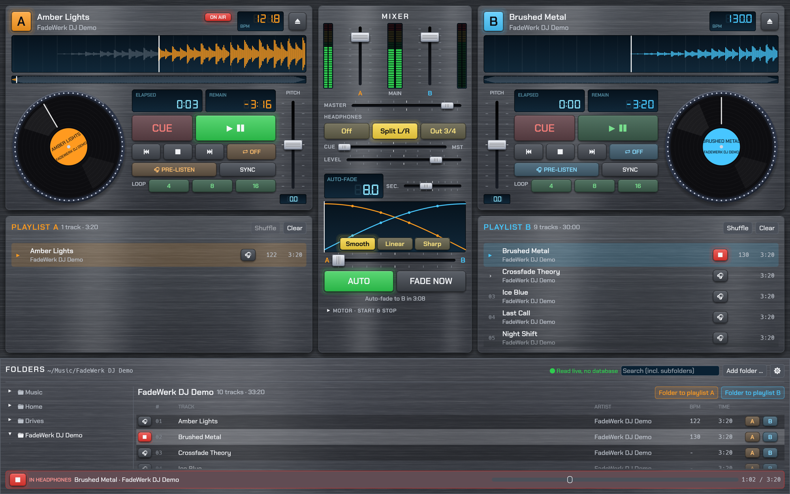

# FadeWerk DJ

**Two decks, two playlists, auto-fade.** A DJ player for macOS, Windows and Linux,
written in Rust. Click a folder and start playing: no database, no library import.


<details>
<summary>“Classic” skin with brushed steel, track playing in the headphones</summary>


</details>

*The screenshots show self-generated demo tracks (`scripts/make-demo-tracks.py`).*

## Features

- **Two decks, each with its own playlist**, and **auto-fade**: when the playing track reaches
  the fade time, the other deck starts and the crossfader blends over. The finished deck then
  loads its next track. Fade curve smooth, linear, sharp or drawn by hand.
- **No import**: click a folder and all tracks, including subfolders, are there instantly.
  Search across title, artist, album and path. Tags, BPM and waveform are analysed in the background.
- **A turntable per deck**: drag the platter or the waveform to scratch forwards and backwards,
  hold it to stop the record, tap the waveform to play or pause.
- **Motor**: start, pause and stop spin up and down like a real turntable
  (adjustable start and stop time). CUE jumps instantly.
- **Transport per deck**: CUE, play/pause, stop, previous, next, repeat (off, track, list),
  eject, pitch ±8 %, sync, loops of 4, 8 or 16 beats.
- **Pre-listening** per deck, in the playlists and right in the folder browser. Headphones via
  split output (left master, right headphones), on outputs 3/4 of a multichannel interface,
  or on a separate second audio device.
- **Mixer** with LED meters (A, main, B), channel faders, master and headphone mix.
  Right-click or double-click resets any fader to its default.
- **Playlists**: fill and reorder by drag & drop, also between A and B; drop tracks straight onto
  a deck. Playlists and settings are kept when you quit.
- **Skins** Night, Classic, Day and Neon, optionally with a brushed steel look.
  The layout adapts to the window size, including 4K monitors.
- User interface in **English and German**.

## Download

Ready-to-run builds are on the [Releases](../../releases) page:

| System | File | Notes |
|---|---|---|
| macOS 11 or later (Apple Silicon and Intel) | `…-macOS.zip` | Unzip and move `FadeWerk DJ.app` to Applications. On first launch **right-click → Open**, because the app is not notarized by Apple. |
| Windows 10/11 (64-bit) | `…-Windows.zip` | Unzip and run `FadeWerk DJ.exe`. SmartScreen warns about unknown apps: **More info → Run anyway**. |
| Linux (x86_64) | `…-Linux-x86_64.tar.gz` | Unpack and run `./fadewerk-dj`. Needs ALSA (or PipeWire/PulseAudio with the ALSA layer). |

## Building

You need a current Rust toolchain ([rustup.rs](https://rustup.rs)).
On Linux you also need the ALSA and X11/Wayland development packages, e.g. on Debian/Ubuntu:

```sh
sudo apt install libasound2-dev libxkbcommon-dev libwayland-dev libx11-dev libdbus-1-dev pkg-config
```

```sh
cargo run --release                     # starts with your music folder
cargo run --release -- ~/Music/Sets     # starts with a specific folder
cargo test --workspace                  # tests for engine, library and playlist logic
scripts/bundle-macos.sh                 # builds "dist/FadeWerk DJ.app" (macOS)
scripts/make-icon.sh                    # regenerates the icons from assets/icon.svg
scripts/make-demo-tracks.py ~/Demo      # generates royalty-free demo tracks
```

GitHub Actions builds a release for all three systems (`.github/workflows/release.yml`)
as soon as a version tag is pushed: `git tag v0.1.0 && git push origin v0.1.0`.

## Architecture

| Part | Purpose |
|---|---|
| `crates/engine` | Real-time audio: decks with motor, scratch, cue and loop, mixer, crossfader, headphone path, auto-fade logic. No GUI or system dependencies, tested. |
| `crates/library` | Live folder reading, tags (lofty), decoding (Symphonia), waveform, BPM detection, background threads. |
| `app` | User interface with egui, audio output with cpal, settings, skins; ties everything together. |

The engine runs in the audio thread and receives commands through a lock-free ring buffer.
It never locks, allocates or frees memory there: ejected tracks are handed back to the UI
thread to be dropped.

Code comments are in German; issues and contributions in English are welcome.

### Developer switches (debug builds only)

| Variable | Effect |
|---|---|
| `FW_DEMO=1` | Spreads the tracks of the start folder across both playlists and starts deck A. |
| `FW_SCREENSHOT=/path/image.bmp` | Saves a screenshot of the window shortly after start, then quits. |
| `FW_SIZE=1600x1000` | Window size. |
| `FW_SKIN=nacht\|classic\|tag\|neon`, `FW_STEEL=1`, `FW_LANG=de\|en` | Look and language. |
| `FW_PREVIEW=1` | Pre-listens to the second track in the demo. |
| `FW_SETTINGS=audio\|sprache\|aussehen` | Opens the settings window. |

With these switches FadeWerk DJ saves nothing.

## Roadmap

- Cache for BPM and waveform, so values show up in the browser right away
- Beat grid with phase, hot cues, key detection, keylock
- MIDI controllers (jog wheels as turntables)
- Sampler and recording
- Importing playlists from other DJ software

## Legal

FadeWerk DJ is an independent development; code, graphics, icon and demo tracks are original work.

Bundled third-party components:

- Fonts [Chakra Petch](https://github.com/cadsondemak/Chakra-Petch) and
  [DSEG](https://github.com/keshikan/DSEG) under the SIL Open Font License 1.1
  (`assets/fonts/OFL-*.txt`)
- Rust libraries mostly under MIT/Apache-2.0; the audio decoders of
  [Symphonia](https://github.com/pdeljanov/Symphonia) under MPL-2.0. The full list ships with
  every release as `THIRD-PARTY-LICENSES.yml`.

## License

Copyright © 2026 Markus Eckert

FadeWerk DJ is free software: you can redistribute it and/or modify it under the terms of the
[GNU General Public License](LICENSE) as published by the Free Software Foundation, either
version 3 of the License, or (at your option) any later version.

FadeWerk DJ is distributed in the hope that it will be useful, but **without any warranty**;
without even the implied warranty of merchantability or fitness for a particular purpose.
See the [LICENSE](LICENSE) file for details.
