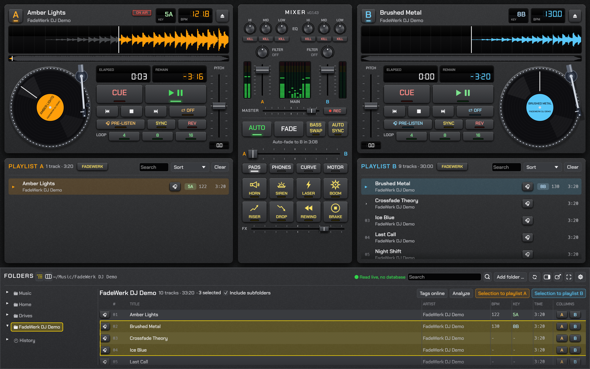
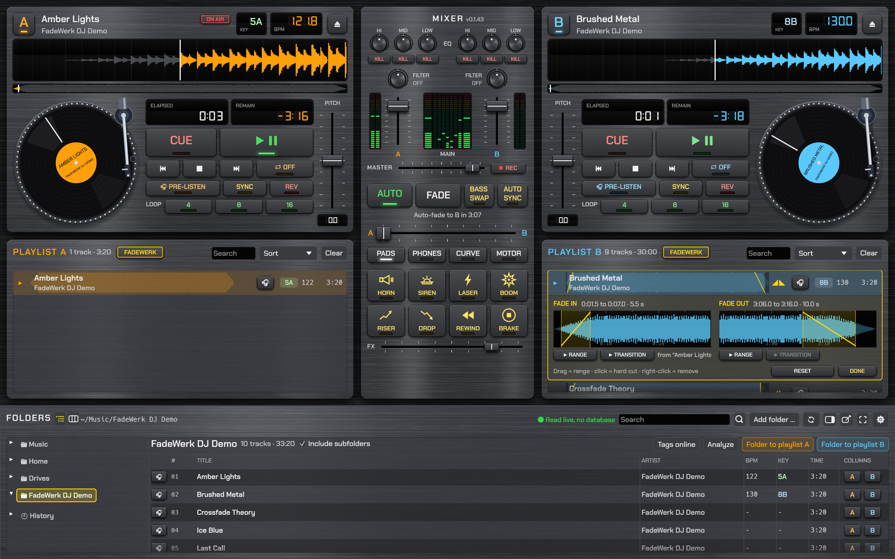

# FadeWerk DJ

**Two decks, two playlists, auto-fade.** A DJ player for macOS, Windows and Linux,
written in Rust. Click a folder and start playing: no database, no library import.





*The screenshots show self-generated demo tracks (`scripts/make-demo-tracks.py`).*

## Features

- **Two decks, each with its own playlist**, and **auto-fade**: when the playing track reaches
  the fade time, the other deck starts and the crossfader blends over. The finished deck then
  loads its next track. Fade curve smooth, linear, sharp or drawn by hand. Optional **bass swap**:
  the incoming track starts without bass and the basses swap halfway through the fade.
  Starting a deck while the other one is stopped glides the crossfader over to it.
  **AUTO SYNC**: a deck that starts while the other one is audible takes over its tempo (also at
  double or half speed) and follows it; once it plays alone, its pitch drifts slowly back to 0 %.
- **FadeWerk mode**: the FADEWERK button in the playlist headers shows the waveform behind every
  track. Click a track to mark where it fades in (first 30 s) and out (last 30 s), or set a hard cut.
  The track then starts at its fade-in range and ends at the end of its fade-out range, so intros and
  outros can be skipped. Auto-fade runs in two phases: the new track fades in while the old one stays
  at full level, then the old one fades out. A side without a range uses half the fade time.
  The ranges belong to the playlist entry, move with it and are saved with the playlists; two small
  triangles in front of the headphone button mark tracks with custom fades.
  In the editor, each range can be previewed on the headphones, alone or as the finished transition
  with the neighbouring track from the other playlist.
- **No import**: click a folder and all its tracks are there instantly, including subfolders
  (switchable per folder; off by default for drives and the home folder). Refresh with 🔄, ⌘R or F5.
  BPM and musical key found by the analysis are remembered; “Analyze” (above the track list and in the
  track menu) and “Detect missing BPM and keys” (folders) run it in the background, decoding each track once for both.
  Quick search across title, artist, album and path; the advanced search (magnifier, ⇧⌘F) filters
  by title, artist, album, file name, folder, genre, year range and BPM range, shown as removable filter chips; “Whole words only” makes “Cro” find “Cro & Bausa” but not “Crosby”; duplicate copies of a track are hidden while searching (can be turned off). Tags, BPM and waveform are analysed in the background.
  Select several tracks or folders (⌘/Ctrl-click, Shift-click) and drag them into a playlist, or use
  the right-click menu: append, play next, shuffle in, spread across A and B, show in Finder.
  Choose the track list columns (artist, album, genre, year, comment, subfolder, file name, format,
  BPM, key, time) and drag their widths; click a column header to sort ascending or descending. All of
  this is remembered.
  Folders show as a tree or, like a column browser, as columns side by side (two buttons next to
  “FOLDERS”); below the decks the columns take 40 % of the width.
- **Musical key in Camelot notation** (8A, 9B …): taken from the tag (any common notation, e.g. “Am”,
  “F#m”, “8A”, Open Key) or detected by FadeWerk DJ itself, never written into your files. Each deck shows
  it next to the BPM, coloured like the Camelot wheel, with **MATCH** when it fits the track on air.
  Playlist rows carry a key badge, and tracks that mix harmonically with the track on air are framed in green
  (same number, or ±1 with the same letter). Without keylock, pitch shifts the key; the deck then shows the
  key you actually hear (a small arrow marks it). Uncertain results (rap, drums only) show “–” rather than a guess.
- **Fast with large collections and network drives**: tags that were read once and the track lists
  of slow folders are remembered (no database: the folder is still read live in the background and
  its result wins, changed files are re-read). Tags are read with four threads. The caches can be
  cleared under Settings → Music; Settings → General can also reset FadeWerk DJ completely.
- **Track info & tags**: right-click a track in the folder browser or a playlist to view and edit
  its tags (title, artist, album, album artist, genre, year, track number, BPM, comment).
- **History**: below the folders, “History” lists every day with the tracks that were played, in order,
  with time and deck. A track counts once it has been audible on master for 30 seconds; tracks until
  6 am belong to the day before. Give a day a name (“Grandma’s birthday”), remove entries, export it as
  M3U8 playlist, CSV table or FadeWerk DJ history file, and import such files or any M3U playlist.
  “Restore” fills playlists A and B again the way the day was played.
  Recording can be switched off in the settings.
- **A turntable per deck**: drag the platter or the waveform to scratch forwards and backwards
  (or use the mouse wheel / trackpad over the platter); let go with momentum and the record coasts on.
  Hold it to stop the record; click the platter to play or pause, right-click to stop; tap the waveform to play or pause.
  Eject slides the record off the deck (A to the left, B to the right); a newly loaded one slides in. Embedded cover art turns the record
  into a spinning picture disc. A tonearm swings onto the record on play, follows the track from the
  outer groove inwards, lifts on pause and returns to its rest on stop; drag it to drop the needle
  anywhere in the track. Prefer a compact deck? Hide the turntables under Settings → Appearance.
- **Motor**: start, pause and stop spin up and down like a real turntable
  (start and stop time adjustable in the Motor tab). CUE jumps instantly.
- **Transport per deck**: CUE, play/pause, stop, previous, next, repeat (off, track, list;
  track repeat fades the end into the start with the fade time and curve), eject, pitch ±8 %, sync, reverse (the record spins down and starts up the other way), loops of 4, 8 or 16 beats.
  The frame of a playing deck flashes red in the last 15 seconds of its track.
- **Pre-listening** per deck, in the playlists and right in the folder browser. Headphones via
  split output (left master, right headphones), on outputs 3/4 of a multichannel interface,
  or on a separate second audio device. A **test tone** next to each device under Settings → Audio checks
  that the right output is chosen.
- **Mixer** with LED meters (A, main, B; on wider windows the main meter adds a spectrum of up to
  ten octave bands between left and right), channel faders, master and headphone mix, and a
  **3-band EQ per deck** (isolator, −26 to +6 dB) with kill buttons, plus a **filter knob** per deck
  (left low-pass, right high-pass, centre off, slight resonance). Below the crossfader, tabs for
  pads, headphones, curve (crossfade curve and fade time) and motor keep the centre column tidy; one is open at a time.
  Right-click or double-click resets any fader to its default; with the mouse over a fader or knob,
  the arrow keys or the mouse wheel move it step by step. Click the fade-time display to type in a value.
- **Record the mix**: REC next to the master fader records what plays on master (before the master volume)
  as WAV (24 bit) or MP3 (320 kbit/s, LAME), by default into `Music/FadeWerk DJ Recordings`, file name with
  date and time. Format and folder under Settings → Recording.
- **Effect pads**: eight DJ effects (air horn, siren, laser, boom, riser, drop, rewind, brake), synthesised by
  FadeWerk DJ itself. Trigger them with a click or the keys 1–8, right-click to pre-listen in the headphones;
  a separate FX fader sets their volume. Replace any of them with your own audio file, name and one of
  16 drawn symbols under Settings → Effects.
- **Playlists**: fill and reorder by drag & drop, also between A and B (or via the right-click menu);
  drop tracks straight onto a deck. The loaded track always moves to the top of its playlist, the
  played ones stay above it. Playlists and settings are kept when you quit.
  After clicking into a playlist or the folder track list, ↑/↓ move through the tracks; Enter loads
  the marked track into the deck (playlists) or pre-listens to it (folder browser).
  Each playlist has a quick search that jumps to the matching track (Enter: next match).
  **Sort** reorders the upcoming tracks: *Shuffle*, or *Harmonic*, which plans both playlists in the
  A – B – A order auto-fade plays them, so that every transition fits by key first and tempo second (missing
  keys are detected first). *Undo* restores the previous order.
- **Skins** Anthracite (default), Silver, Night, Classic, Day and Neon; Anthracite and Silver look like anodised aluminium hi-fi gear, all optionally with a brushed steel look.
  The layout adapts to the window size, including 4K monitors; drag the handle between decks and
  playlists to share the height, and zoom with ⌘/Ctrl +, − and 0 (70 to 150 %). **Full screen** via the button
  in the folder browser, F11 or ⌃⌘F on macOS. On wide monitors, the button next to it moves the
  folder browser from below the decks to their right (folder tree above the track list).
  For two monitors, **detach the folder browser into a window of its own**: its position and size are
  remembered, folders sit above or to the left of the tracks, and tracks can be dragged from there onto
  the playlists and decks in the main window (not on Wayland). Closing the window docks it again.
  The version number sits next to the MIXER heading; clicking it opens “About”.
- **Light on resources**: when nothing is playing, the interface only redraws on input. A
  **lightweight display** for older or slower computers drops shadows, gradients, glow and the
  spectrum and limits drawing to 30 frames per second.
- **Keeps playing in the background**: auto-fade and the next track also work while the window is
  minimised or covered by another app. When one playlist runs out, the other deck plays on alone.
- **No sleep while playing**: display and computer stay awake as long as a deck or pre-listen is
  playing (can be switched off).
- **Quiet while you play** (optional, Settings → Audio): mutes system alert sounds while FadeWerk DJ is
  running, and on Windows and Linux other programs too (as in the volume mixer). On macOS, the master
  device can instead be used exclusively, so no other program plays on it. Everything comes back when you
  quit, even after a crash (on the next start).
- User interface in **English and German**.
- **No telemetry, no account.** The only network request is an optional check for new versions on
  GitHub. FadeWerk DJ asks once before enabling it (switch it on or off under *Settings → General*; track recognition online under *Settings → Music*);
  it sends nothing about your music or folders.

## Download

Ready-to-run builds are on the [Releases](../../releases) page, one release per version.

| System | File | Notes |
|---|---|---|
| macOS 11 or later (Apple Silicon and Intel) | `…-macOS.dmg` or `…-macOS.zip` | Easiest: the [one-line Terminal install](#macos-cannot-be-verified) below. Or open the DMG and drag FadeWerk DJ to Applications (or unzip and move it there). The app is not notarized by Apple, so see below for the first launch. |
| Windows 10/11 (64-bit) | `…-Windows-Setup.exe` or `…-Windows.zip` | Run the setup: it installs FadeWerk DJ to Program Files, adds it to the Start menu and (optionally) puts a shortcut on the desktop; uninstall under Settings → Apps. Or unzip the portable version and run `FadeWerk DJ.exe`. SmartScreen warns about unknown apps: **More info → Run anyway**. |
| Linux (x86_64) | `…-Linux-x86_64.tar.gz` | Unpack and run `./fadewerk-dj`, or run `./install.sh` to add it with its icon to the application menu (per user, `./install.sh --uninstall` removes it). Needs ALSA (or PipeWire/PulseAudio with the ALSA layer). |
| Linux (arm64) | `…-Linux-arm64.tar.gz` | The same for 64-bit ARM, e.g. Raspberry Pi 4 or 5 with 64-bit Raspberry Pi OS (not yet tested on a real Pi). On a Pi 4, the lightweight display (Settings → Appearance) is recommended. |

### macOS: "cannot be verified"

The app is signed with the project's own (self-signed) certificate but not notarized (that needs a
paid Apple Developer account).
Files downloaded in the browser get a quarantine flag, and Gatekeeper then refuses to
open the app.

**Easiest: install from Terminal.** This downloads the latest release, copies it to Applications
and starts it. Downloads made this way carry no quarantine flag, so there is no security prompt.
Running the same command again updates to the newest version.

```sh
curl -fsSL https://raw.githubusercontent.com/eckonator/fadewerk-dj/main/scripts/install-macos.sh | bash
```

**Installed from the DMG or ZIP?** On recent macOS versions (Sequoia and later) *System Settings →
Privacy & Security → Open Anyway* often does not help. Remove the flag in Terminal instead:

```sh
xattr -dr com.apple.quarantine "/Applications/FadeWerk DJ.app"
```

Then open the app as usual. You need to do this once per downloaded version. The app is
open source; you can also build it yourself (see below), which needs no workaround.

### Updates

With the update check switched on (asked on first start, Settings → General), FadeWerk DJ shows
a bar when a new version is out. **Update now** downloads and installs it and restarts the app
(only while no deck is playing):

- **macOS:** the new app replaces the installed one, but only if it is signed with the same
  certificate as the installed app. If the Applications folder is not writable for you, macOS asks
  for an administrator password. No quarantine flag, so no security prompt.
- **Windows:** installed with the setup, the new setup is downloaded and run (Windows asks for
  administrator rights) and starts the new version. The portable `FadeWerk DJ.exe` from the zip is
  replaced in its folder (the folder must be writable).
- **Linux:** when installed with `./install.sh`, the new archive is unpacked and its `install.sh` run.

Otherwise the bar links to the download page.

## Building

You need a current Rust toolchain ([rustup.rs](https://rustup.rs)).
On Linux you also need the ALSA and X11/Wayland development packages, e.g. on Debian/Ubuntu:

```sh
sudo apt install libasound2-dev libxkbcommon-dev libwayland-dev libx11-dev libdbus-1-dev pkg-config
```

```sh
cargo run --release                     # starts with your music folder
cargo run --release -- ~/Music/Sets     # starts with a specific folder
cargo test --workspace                  # tests for engine, library and playlist logic
scripts/bundle-macos.sh                 # builds "dist/FadeWerk DJ.app" (macOS)
scripts/make-dmg.sh                     # packs it into a DMG with install window (needs `pip install dmgbuild`)
scripts/make-icon.sh                    # regenerates the icons from assets/icon.svg
scripts/make-demo-tracks.py ~/Demo      # generates royalty-free demo tracks
```

GitHub Actions builds all three systems on every push to `main` (`.github/workflows/release.yml`)
and publishes them as release `v<version>`, with the version taken from `Cargo.toml`.
A push without a version change replaces that release; raise `version` for a new one.

## Architecture

| Part | Purpose |
|---|---|
| `crates/engine` | Real-time audio: decks with motor, scratch, cue, loop and reverse, mixer, crossfader, EQ, filter, recording tap, headphone path, sampler for the effect pads, spectrum bands for the main meter, auto-fade logic. No GUI or system dependencies, tested. |
| `crates/library` | Live folder reading, tags (lofty), decoding (Symphonia), waveform, BPM detection, synthesis of the built-in effects, background threads. |
| `app` | User interface with egui, audio output with cpal, settings, skins; ties everything together. |

The engine runs in the audio thread and receives commands through a lock-free ring buffer.
It never locks, allocates or frees memory there: ejected tracks are handed back to the UI
thread to be dropped.

Code comments are in German; issues and contributions in English are welcome.

### Developer switches (debug builds only)

| Variable | Effect |
|---|---|
| `FW_DEMO=1` | Spreads the tracks of the start folder across both playlists and starts deck A. |
| `FW_SCREENSHOT=/path/image.bmp` | Saves a screenshot of the window shortly after start, then quits. |
| `FW_SIZE=1600x1000` | Window size. |
| `FW_SKIN=anthrazit\|silber\|nacht\|classic\|tag\|neon`, `FW_STEEL=1`, `FW_LITE=1`, `FW_LANG=de\|en` | Look (`FW_LITE` = lightweight display) and language. |
| `FW_PREVIEW=1` | Pre-listens to the second track in the demo. |
| `FW_SELECT=1` | Selects tracks 2 to 4 in the folder browser. |
| `FW_HISTORY=1` | Creates two example days in the history (one with a missing file) and opens the newer one. |
| `FW_TAGS=1` | Opens “Track info & tags” for the first track. |
| `FW_BPM=1` | Analyzes the missing BPM and keys of the start folder. |
| `FW_SEARCH="genre=rock,year=1980-1989"` | Opens the advanced search with these fields. |
| `FW_COLUMNS=artist,album,genre,…` | Shows these columns in the track list. |
| `FW_SORT=artist` / `FW_SORT=bpm:desc` | Sorts the track list by this column. |
| `FW_BROWSER=rechts\|fenster`, `FW_FOLDERS=spalten` | Folder browser to the right of the decks or in its own window; folders as columns. |
| `FW_QUIET=1` | Lets a debug build mute other sounds (normally only installed builds touch the system). |
| `FW_POINTER=x,y` | Moves the mouse there (points); `x,y,1` clicks, `x,y,2` right-clicks, `x1,y1,x2,y2` drags. |
| `FW_SETTINGS=allgemein\|audio\|effekte\|sprache\|aussehen\|ueber` | Opens the settings window. |
| `FW_TAB=pads\|kopfhoerer\|fade\|motor\|zu` | Opens this tab below the crossfader (`zu` = all closed). |
| `FW_UPDATE_ASK=1` | Shows the question whether to check for updates. |
| `FW_UPDATE_URL=file:///path/release.json` | Checks for updates against your own release JSON (`tag_name`, `html_url`, optionally `assets[].browser_download_url`). |

With these switches FadeWerk DJ saves nothing (`FW_PERSIST=1` forces saving, best with a separate `HOME`).

## Roadmap

- Cache for the deck waveform, so it shows up right away (the small playlist waveforms are cached already)
- Keylock (tempo changes without changing the key; next step)
- Beat grid with phase, hot cues
- Suggesting the next track by key and BPM
- MIDI controllers (jog wheels as turntables)
- Mix recording
- Importing playlists from other DJ software

## Legal

FadeWerk DJ is an independent development; code, graphics, icon, effect sounds and demo tracks are original work.

Bundled third-party components:

- Fonts [Chakra Petch](https://github.com/cadsondemak/Chakra-Petch) and
  [DSEG](https://github.com/keshikan/DSEG) under the SIL Open Font License 1.1
  (`assets/fonts/OFL-*.txt`)
- Rust libraries mostly under MIT/Apache-2.0; the audio decoders of
  [Symphonia](https://github.com/pdeljanov/Symphonia) under MPL-2.0. The full list ships with
  every release as `THIRD-PARTY-LICENSES.yml`.

## License

Copyright © 2026 Markus Eckert

FadeWerk DJ is free software: you can redistribute it and/or modify it under the terms of the
[GNU General Public License](LICENSE) as published by the Free Software Foundation, either
version 3 of the License, or (at your option) any later version.

FadeWerk DJ is distributed in the hope that it will be useful, but **without any warranty**;
without even the implied warranty of merchantability or fitness for a particular purpose.
See the [LICENSE](LICENSE) file for details.
